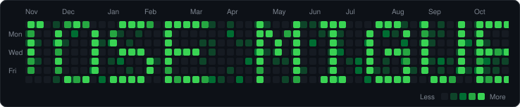

 

 

## 👋 Sobre mí &nbsp;/&nbsp; About me

<table>
<tr>
<td width="50%" valign="top">

🇪🇸 **Español**

Diseño y desarrollo **APIs y servicios backend con Node.js y TypeScript**.

Trabajo en una compañía internacional de **iGaming 100% online**, en el backend que sirve a **aplicaciones nativas**: servicios fiables, rápidos y pensados para evolucionar sin dolor.

Me muevo bien entre el diseño de APIs, la calidad del código y la operación en producción. Prefiero soluciones simples, medibles y fáciles de mantener.

</td>
<td width="50%" valign="top">

🇬🇧 **English**

I design and build **backend APIs and services with Node.js and TypeScript**.

I work at an international, **100% online iGaming** company, on the backend behind **native apps**: reliable, fast services designed to evolve without pain.

I work across API design, code quality and production operations. I favour solutions that are simple, measurable and easy to maintain.

</td>
</tr>
</table>

 

## 🛠️ Stack

<table>
<tr>
<td align="center" width="110"> <b>Node.js</b></td>
<td align="center" width="110"> <b>TypeScript</b></td>
<td align="center" width="110"> <b>JavaScript</b></td>
<td align="center" width="110"> <b>Git</b></td>
<td align="center" width="110"> <b>GitLab</b></td>
</tr>
</table>

 

## 🚀 Proyectos personales &nbsp;/&nbsp; Side projects

### 🧸 [Hello Tom](https://github.com/jmromera/hello-tom) &nbsp;🔒 privado / private

       

🤖 **Un profesor de inglés hecho con IA para niños de 3 a 6 años.**

Tom es un **personaje generado por IA**: su aspecto, su personalidad y su voz salen de modelos de inteligencia artificial. Aparece en la tele y el niño habla con él usando el móvil como micrófono. No hay diálogos grabados: cada respuesta se genera en el momento.

Por dentro, Tom se conecta a varios servicios de **IA de voz** que trabajan en cadena y en tiempo real:

- 🎙️ **Oído:** la voz del niño viaja por WebSockets a un servidor **Node.js** (Fastify) y **Deepgram** la convierte en texto con reconocimiento de voz por IA.
- 🧠 **Cerebro:** un modelo de lenguaje (**Claude**, de Anthropic) entiende lo que ha dicho el niño y decide la respuesta. Se adapta a su edad, a su nivel y al idioma que hablan en casa.
- 🗣️ **Voz:** **ElevenLabs** convierte esa respuesta en la voz sintética de Tom, que suena natural.

Los padres configuran el perfil del niño con un asistente al que pueden contestar hablando, porque también usa la IA, y fijan un límite de uso diario.

> 🇬🇧 *An AI-generated character that teaches English to kids aged 3–6. Tom lives on the TV and talks back in real time through a Node.js backend that chains AI voice services: Deepgram (speech-to-text), Claude (the conversational brain) and ElevenLabs (Tom's synthetic voice).*

### 🍽️ [MenuMulticanal](https://github.com/jmromera/menumulticanal) &nbsp;🔒 privado / private

      

**Publica una vez, aparece en todas partes.** SaaS para que un bar o restaurante escriba su menú del día una sola vez y lo tenga a la vez en su web pública, en un QR para las mesas, en un PDF para imprimir y en imágenes listas para Instagram, Facebook o WhatsApp. Monorepo en TypeScript con API en **Node.js** (NestJS), web en Next.js y un worker que genera las imágenes con Chromium a partir de plantillas. Hecho con TDD, PRs pequeñas, CI y tests visuales que comparan cada imagen con su referencia aprobada.

> 🇬🇧 *A SaaS that lets restaurants write their daily menu once and publish it everywhere: public web page, table QR code, printable PDF and social-media images. Node.js + NestJS API, Next.js front end and a background rendering worker.*

### 🎭 [Plan Cerca](https://github.com/jmromera/CulturalEventsAppDesign) &nbsp;· [plancerca.com](https://plancerca.com)

   

Web para descubrir conciertos, teatro, exposiciones y eventos deportivos en Madrid y Barcelona: buscar eventos, artistas y recintos, ver los detalles y guardar favoritos. Nació como trabajo de la asignatura de **Interacción Persona-Ordenador**, así que el foco está en la usabilidad, la accesibilidad y el diseño responsive. Está publicada y se puede probar en [plancerca.com](https://plancerca.com).

> 🇬🇧 *A web app to discover cultural, sports and leisure events in Madrid and Barcelona. Built for a Human-Computer Interaction course, with a focus on usability and accessibility. Live at [plancerca.com](https://plancerca.com).*

 

## 📊 GitHub

  
  
   
  

 

  

 

## 📫 Contacto &nbsp;/&nbsp; Contact

  
  

 

